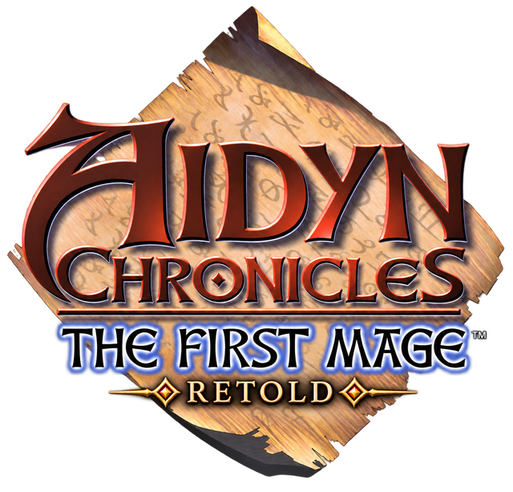

  

# Aidyn Chronicles Retold

A PC remake of *Aidyn Chronicles: The First Mage*, the Nintendo 64 role-playing game, made by mdoulos in C# and
Godot.

Retold retells the game. The story is the original's and its main line stays, with changes and additions that
expand the lore the original condensed. The mechanics and the art are being remade with it: new character
models, a camp you sit down at, a party that grows hungry and tired, and menus drawn for a PC. Underneath is
a reimplementation of the original's engine running the original's content as your ROM has it, so the game you
remember is the ground everything new is laid over. An editor comes with it, growing into a full mod editor in
the spirit of OpenMW-CS, so players can make mods of their own.

No game content is included. You bring your own copy of the North American 1.0 ROM, unmodified: a ROM hack
isn't imported, so the game is the same for everyone
([ADR 0038](docs/adr/0038-only-the-unmodified-1.0-rom-imports.md)).
Retold isn't affiliated with H2O Entertainment or THQ; Aidyn Chronicles is their trademark.

## Getting started

1. Download the latest build from [Releases](https://github.com/mdoulos/aidyn-retold/releases): the Windows
   installer or portable zip, the Linux tarball, or the macOS disk image. Retold is in alpha.
2. Run `acre` (`acre.exe` on Windows).
3. On the first run, choose your ROM and let it import. It takes a minute, once.
4. Play.

To build from source, install the .NET 10 SDK that `global.json` pins and run `dotnet test` from the repository
root. `acre import <rom>` imports the ROM, and `tools/godot.ps1 --path src/AidynRetold.Game` runs the game on
it. [CLAUDE.md](CLAUDE.md) maps the code, the ROM's formats, the systems and the docs.

## What's new

- **A remake, not a re-release.** Retold's own design comes first; the original is where it starts, not a
  limit. Graphic Quality's *Original* setting brings back the original's look for anyone who wants it.
- **New characters.** Alaron is remodelled from head to toe, with hair that moves, a neck that bends and hands
  that are never quite still. The rest of the party follows, on shared bodies that every piece of armor fits.
- **Camping is a screen.** The party gathers round the fire to talk, cook, brew, make armor and rest for as
  long as it chooses, and Alaron sits down among them in 3D.
- **Survival.** Members grow hungry and tired, food spoils, and Cook joins the skills.
- **Painted art and a typeface.** Portraits and icons painted by the sister project Aidyn ReChronicled, text in a
  typeface, sharp at any size, and parchment menus as wide as the window.
- **Any resolution, any frame rate.** Draw distance, object distance, model and surface detail go well past the
  console's, with smooth animation blending and thicker rain and snow.
- **PC controls.** Every control can be rebound, the mouse drives the menus and turns the camera, and there's a
  jump and a full run.
- **Sound.** Six volumes, new music for Gwernia, a voice for each line of a conversation, and a crackling
  campfire.
- **Mods.** Everything is a plugin: the original's content, the remade game laid over it, and any mod over both.
  The editor saves into a mod, the world can be edited in Blender, and a broken mod is reported rather than
  crashing the game.

[docs/changes](docs/changes/README.md) lists everything Retold changes, by category, with every bug it fixes and
the few it keeps on purpose.

## How it's built

Retold isn't a decompilation. The engine is written anew in C#, and the ROM's machine code, its data and an
emulator are read to settle how each system works, with the addresses cited in the docs. That leaves the code
free to grow past the original, at the cost of perfect accuracy and a great deal of testing.

The aim is the game as you remember it, down to some of its stranger quirks. But it was held back by its
hardware and rushed out the door, so its bugs are fixed where they hurt it, each fix a deliberate choice, and a
few are kept because they're part of how it plays.

Timing is one example. Much of the original (the weather, animated textures, some of its random rolls) is tied
to its frame rate, which ran slow and unsteady. Retold keeps the feel at any frame rate: weather and animated
textures move as they did at 20 frames a second, and the camera a little faster, as at 30.

Some of the bugs it fixes:
- The mushroom in Roog Cave no longer blocks the passage.
- Rain and snow splash on what you see, not on invisible collision boxes.
- Weather carries on into cut-scenes rather than clearing and starting over.
- The time of day and compass stay hidden in the interiors that hide them, even after loading a save there.
- Lowering a stat with a spell no longer freezes the combatant for the rest of the battle.

And some it keeps:
- Spirit and Starlight Shield leave a level of protection behind each time they end.
- Wind cast on an ally raises its Stamina for good.

## Status

Retold is in alpha. The original's whole game plays through on the reimplemented engine, and the remake is
being built over it.

| Area | Status |
| --- | --- |
| Exploring | ✅ Complete, and played from a new game through Pochanargarat's defeat. |
| Story and quests | ✅ The main story plays through with no quest or flag bugs found. The side quests need a fuller test. |
| The prologue | ✅ Played side by side with the original in an emulator, and what differed is fixed. |
| Cut-scenes | ⚠️ Every story cut-scene plays through. A few still stage a little differently from the original. |
| Combat | ⚠️ Complete. The opening fights and the special battles are tested; every spell in every situation isn't yet. |
| Menus and camp | ✅ Complete, redrawn, with the new camp screen. |
| Character models | ⏳ Alaron is remodelled; the rest of the party is under way. |
| Editor | ⏳ Browses the whole game and edits characters, items, spells, shops and rules into a mod. |
| The retelling | ⏳ The story's changes and additions are to come. |

Next is matching the rest of the original's content, then the retelling itself. The
[roadmap](docs/roadmap.md#where-things-stand) has the details.

## Credits

Aidyn Chronicles Retold is mdoulos's project. Much of its code is written by Claude models under mdoulos's
direction and playtesting.

- [Aidyn ReChronicled](https://github.com/spitzdano/AidynReChronicled) by Spitzdano: a sister project, a static
  recompilation of the original with enhancements of its own. The two collaborate and share their assets freely
  both ways; its painted art and restored sound are carried in Retold's releases
  ([ADR 0034](docs/adr/0034-retold-and-rechronicled-collaborate.md)).
- [AidynEditor](https://github.com/TiberGuy/AidynEditor) (MIT licensed): used to cross-check the database's
  fields.
- [Marcellus SC](https://fonts.google.com/specimen/Marcellus+SC) by Astigmatic (Brian J. Bonislawsky), under the
  SIL Open Font License 1.1 ([assets/fonts/OFL.txt](assets/fonts/OFL.txt)): the typeface the text is drawn in.
- Retold began in October 2026 as a fork of [HBHT](https://github.com/Aquatakat/hbht) by Aquatakat, under the MIT
  license, whose copyright notice [LICENSE](LICENSE) keeps. The code it grew from used a community decompilation
  early on as a map to the machine code; nothing was copied from it, and Retold reads and cites none
  ([ADR 0015](docs/adr/0015-the-port-no-longer-reads-the-decomp.md)).

## License

The code and docs in this repository are [MIT licensed](LICENSE). The typeface in `assets/fonts` is under its own
license, the SIL Open Font License 1.1. The logo at the top of this page is the original's title logo with
Retold's name under it; like the art and music a release carries, it isn't under the MIT license. The
`NOTICE.md` beside a release's `LICENSE` says whose the art and music are and on what terms
([ADR 0041](docs/adr/0041-the-art-and-music-are-the-private-repositorys.md),
[ADR 0047](docs/adr/0047-the-readme-shows-the-logo.md)). Any imported game content remains the property of its
rights holders.
